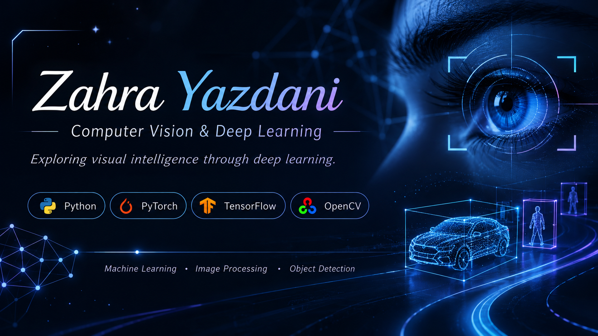

 

 

### Computer Vision | Deep Learning | Artificial Intelligence

 

---

## About Me

I am a Computer Engineering graduate from the University of Tabriz, interested in Artificial Intelligence, Deep Learning, and Computer Vision.

I enjoy exploring how intelligent systems learn from data and interpret visual information. I develop my knowledge through self-study, practical implementations, and hands-on projects.

- Interested in Computer Vision and Image Processing
- Focused on Machine Learning and Deep Learning
- Experienced with Python and Deep Learning frameworks
- Interested in building intelligent systems and research-oriented projects

## Technical Skills

### Programming

  

### Data Science & Machine Learning

  
  
  
  
  

### Deep Learning & Computer Vision

  
  
  
  

### Development Tools

  
  
  

## Explore My Work

My repositories include practical implementations, experiments, and projects related to Machine Learning, Deep Learning, and Computer Vision.

## GitHub Activity

---

**Always learning. Always building.**

